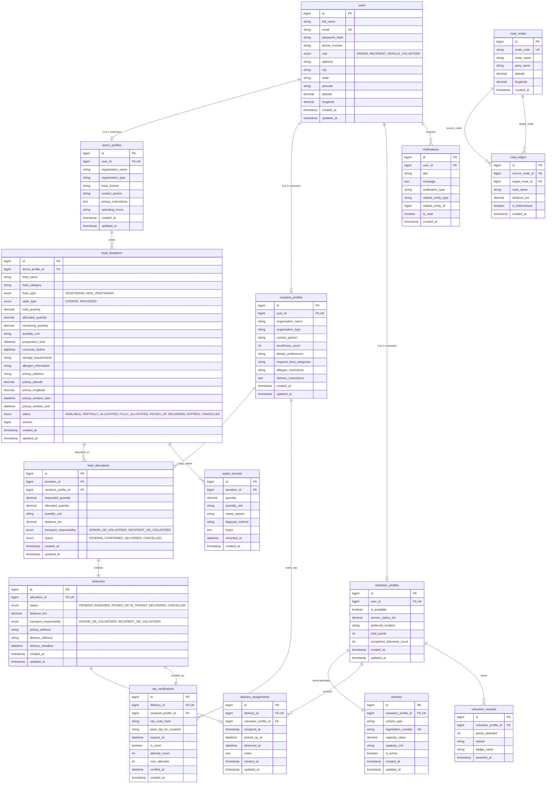

# Entity Relationship (ER) Diagram: NourishNet

This document outlines the complete relational model for **NourishNet**. It visualizes entity cardinalities, foreign key references, and operational workflows.

## Visual ER Diagram (Mermaid)

---

## Instructions to Render and Export

1. **In Markdown Preview / VS Code**: Ensure Mermaid preview plugin is enabled or view directly in GitHub / IDE markdown viewer.
2. **Online Mermaid Live Editor**:
   - Copy the mermaid block above or content of [er-diagram.mmd](file:///c:/Users/Poorani%20R/OneDrive/Documents/NourishNetSmartFoodDistribution/docs/er-diagram.mmd).
   - Paste into https://mermaid.live to generate PNG, SVG, or PDF exports for your project report.
3. **In MySQL Workbench**:
   - You can also generate a physical model directly from the database by selecting **Database -> Reverse Engineer...**, selecting `nourishnet`, and exporting the EER Diagram as an image!
